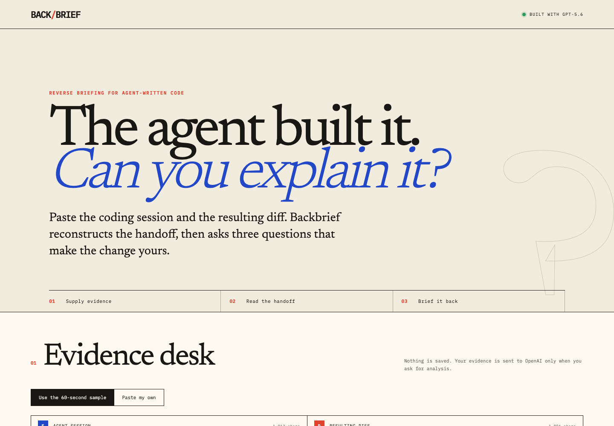
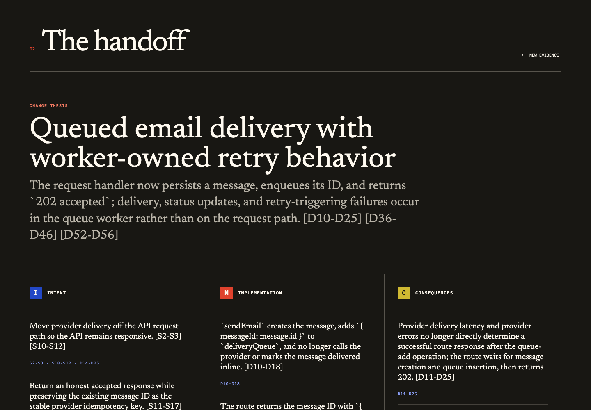
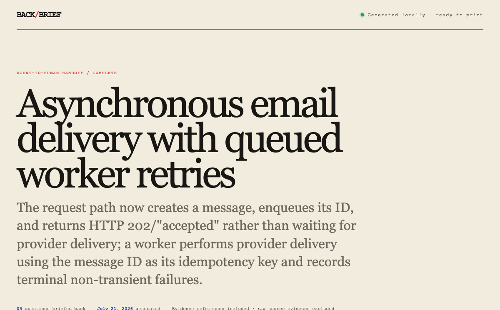
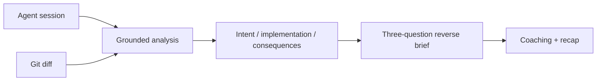

# Backbrief

> The agent built it. Backbrief the change.

Backbrief turns a coding-agent session and its resulting diff into a grounded
handoff, then asks the developer three free-response questions that make the
change theirs. It is a teaching loop, not a score, approval, or merge gate.

Built for the **Developer Tools** track of OpenAI Build Week 2026.

## Try it

**Live app: [backbrief.vercel.app](https://backbrief.vercel.app)**

The app opens with a fictional, sanitized email-queue example. Check the consent
box and click **Build my Backbrief**; no account or setup is needed. You can also
paste your own coding session and `git diff`.

### Supported platforms

The judge path is the public web app in any current desktop or mobile browser;
the deployed flow has been exercised in Safari and Chromium at desktop and
mobile viewport sizes. Local development is supported anywhere Node.js 24 and
pnpm 10 run. No browser extension, Codex plugin, or operating-system integration
is required.







## Why it exists

Coding agents can produce a working change faster than a developer can form a
durable mental model of it. Code review tools typically ask whether a change is
good. Backbrief asks a different question: can the person inheriting the change
explain its intent, mechanism, and consequences?

The product has one deliberately narrow loop:

1. Supply the agent session and resulting diff.
2. Read an evidence-cited handoff: intent, implementation, consequences.
3. Answer three questions, one at a time.
4. Receive concise coaching and leave with a recap in your own words.
5. Download a self-contained HTML receipt you can keep, print, or attach to a
   pull request without including the raw session or diff.

## How it works



- The server labels every session line `S1…Sn` and diff line `D1…Dn` so GPT-5.6
  can cite its evidence.
- Every citation is interactive: select it to inspect the exact source lines in
  an in-browser evidence plate.
- Structured Outputs constrain both the handoff and coaching responses with Zod
  schemas.
- Raw session and diff text are sent only to the analysis call. Coaching sees
  only the generated question, teaching point, and developer answer.
- The finished recap can be downloaded as a self-contained HTML receipt. It is
  generated entirely in the browser, escapes model and developer text, and
  carries evidence references without copying the raw source evidence.
- OpenAI Responses API calls use `store: false`. Backbrief has no database,
  accounts, analytics, or raw-input logging. Backbrief does not retain submitted
  evidence, but OpenAI may retain API content for abuse monitoring under its
  [API data controls](https://developers.openai.com/api/docs/guides/your-data#data-retention-controls-for-abuse-monitoring).
- Inputs and outputs are bounded and validated; model errors return generic,
  stable API responses without echoing private evidence.
- The production deployment adds a Vercel WAF fixed-window limit of 12 requests
  per minute per IP across `/api/*`; the in-process limiter remains a
  defense-in-depth fallback.

See [the API contract](docs/system/API.md) for exact request, response, and error
shapes.

## Run locally

Requirements: Node.js 24+, pnpm 10+, and an OpenAI API key with access to
GPT-5.6.

```bash
git clone https://github.com/davisbuilds/backbrief.git
cd backbrief
pnpm install
cp .env.example .env.local
# Add your OPENAI_API_KEY to .env.local
pnpm dev
```

Open `http://localhost:3000` and use the built-in sample.

## Verify it

```bash
pnpm test       # request contracts, evidence references, route behavior
pnpm lint
pnpm typecheck
pnpm build

# Or run every gate:
pnpm verify
```

The route tests inject a fake model gateway. They verify behavior at the HTTP
boundary, including malformed JSON, invalid evidence, rate limits, private-data
non-disclosure, and the absence of scoring/verdict fields. Receipt tests verify
HTML escaping, self-containment, print styling, and safe filenames. The deployed
path was also exercised end to end against GPT-5.6 and in desktop/mobile browsers.

## Built with Codex

Codex was the primary development partner from blank directory to deployed
vertical slice. The collaboration included:

- researching the hackathon rules and adjacent submissions;
- narrowing the concept to a differentiated, finishable teaching loop;
- writing the falsifiable product spec, API contract, and execution plan;
- using red/green TDD for schemas, evidence references, and server routes;
- implementing the GPT-5.6 Structured Outputs gateway and the editorial UI;
- running the real-model smoke test, browser walkthrough, responsive visual
  checks, security scan, and release gates;
- preparing the public repository, demo script, and Devpost submission copy.

The most useful human/agent decision was a scope cut: no GitHub OAuth, database,
generic session importer, scoring, or merge verdict. That left enough time to
make the one important loop real and testable.

## Deliberate limits

- Line references ground claims, but Backbrief is not a formal verifier.
- The in-memory limiter is best-effort and not distributed; production relies
  on the Vercel WAF rule for shared edge enforcement.
- Inputs are currently pasted; provider-specific session importers are future
  work only if users repeatedly finish the core loop.

## License

[MIT](LICENSE)
